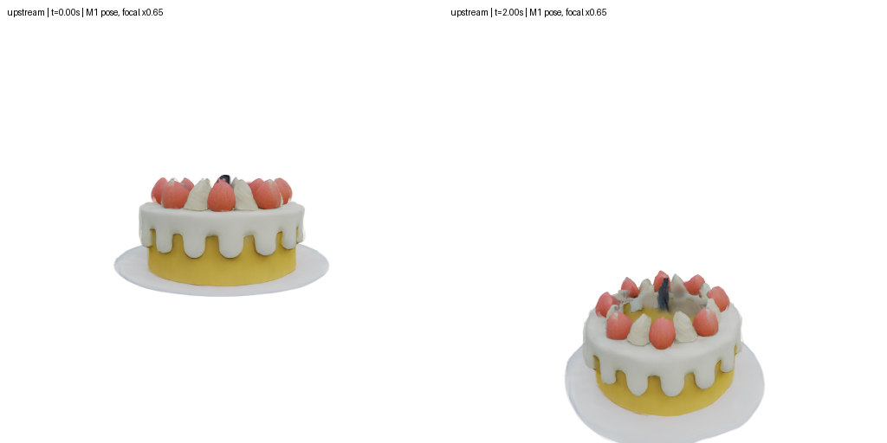

# M4 MPM 前向仿真迁移验收报告

本阶段已完成：真实 M1 预测 → CPU 原算法初始化/填充 → NPU MPM 前向仿真 → 动态 Gaussian 渲染 → 状态保存恢复。原仓基线为 `7722175ba55db54fd430a7d29a4407b8f8ffe6b6`；原仓未改动。实现计划见 [MPM_PLAN.md](MPM_PLAN.md)。

## 环境与实现

单张 Ascend910B3，Python 3.11.4、PyTorch 2.7.1+cpu、TorchNPU 2.7.1.post8、CANN 9.1.0。核心依赖未升级；uv 的 `mpm` 组新增 PyMCubes 0.1.6，复用已锁定 SciPy。构建信息见 [mpm_build.json](reports/mpm_build.json)。

三类项目内 Ascend C 算子：Jacobi SVD、P2G 贡献生成、G2P/粒子更新。Profiler 将三者记录为 `KERNEL_MIX_AIC`，向量代码使用 `dav-c220-vec`；同一真实子步 trace 内未出现 `KERNEL_AICPU`。网格累加/读取复用 IndexAdd/gather，未编写第四类算子，未使用主机粒子/网格求解 fallback。

本构公式由 TorchNPU 执行，一次 SVD 的谱基在返回映射和应力之间复用；本阶段没有把全部本构公式融合进 Ascend C。完整子步测量显示粒子/网格传输为主要瓶颈，因此将其作为后两类融合算子的实现重点。保留 `--transfer-backend torch` 和 `--svd-backend torch` 对照路径。

保留原仓六种材料的实际分支：metal 不执行被注释的返回映射，snow 不添加教科书雪塑性。默认 `upstream` 保留 surface collider 最终清零速度等行为；`corrected` 仅修复碰撞速度赋值和顺序释放层数/时间。七类边界、初始固定选择掩码、APIC/RPIC/PIC、材料内部状态和增量协方差接口均已迁移。

## 数值检查

| 检查 | 实际结果 |
| --- | --- |
| CPU MPM | 27 passed；14项NPU专用测试跳过 |
| NPU MPM | 41 passed；六种材料分别用张量/融合传输完成100子步，含硬化/损伤和常量/仿射速度解析检查 |
| M1/M2/M3 NPU总回归 | 原有53项全部通过 |
| SVD测试矩阵 | 2053个；包括旋转、剪切、重复/近零奇异值、反射和零矩阵 |
| 最大相对重构误差 | `2.99e-7`，要求≤`1e-5` |
| 最大正交误差 | `5.05e-7`，要求≤`1e-5` |
| 小场景状态误差 | 每字段单步≤`1e-4`、100子步≤`1e-3`；阈值未放宽 |
| CPU保存恢复 | 后续状态逐元素完全一致 |
| 真实末状态NPU恢复 | 从第10000步继续，经保存恢复后到第10008步；最大归一化差异`6.68e-5`，小于预设`1e-3` |

CPU 使用独立标量 NumPy FP64 公式参考，重新分解返回映射后的 F，验证设备实现的谱复用。另有质量守恒、仿射/常量速度、粒子选择、RPIC/PIC、协方差、材料标签与边界时间检查。逐项结果见 [CPU检查](reports/mpm_cpu_tests.txt)、[NPU检查](reports/mpm_npu_tests.txt)、[原有回归](reports/mpm_npu_regression.txt) 和 [恢复报告](reports/mpm_resume.json)。

初次 sand 100子步应力误差超过预设阈值。定位后改用数学等价的 `F_trial + U diag(s_new-s_old) Vᵀ` 更新，避免反复重建引入 FP32 漂移，并对 SVD 的 V 做正交化；相同测试和原阈值复验通过。3×3乘法使用显式向量乘加，且求解器显式关闭外部 autocast。

原预测中的极薄 Gaussian 在 FP32 构造初始协方差时，已经产生约`-5.85e-8`的相对负特征值。验收检查有限值与尺度归一化主子式/行列式的半正定性，容差`1e-6`；没有修改、截断或重新分解这些协方差。

## 性能与完整 cake

同一完整初始粒子包、同步预热后7次测量的中位数：

| 项目 | 张量传输基线 | Ascend C融合传输 |
| --- | ---: | ---: |
| 219416粒子完整子步 | 76.94 ms | 38.51 ms |
| 本构＋SVD | 11.98 ms | 11.99 ms |
| P2G | 28.05 ms | 14.68 ms |
| 网格与边界 | 1.18 ms | 1.17 ms |
| G2P | 35.44 ms | 10.44 ms |

完整子步约加速 **2.00倍**。两种传输路径都使用自定义 SVD；另测20万个3×3矩阵，自定义 SVD 为5.25 ms，现有设备 AI CPU SVD 为470.00 ms，约89.6倍。不能将该分解倍数当作整个求解器加速倍数。[SVD证据](reports/mpm_svd.json)、[多规模子步测量](reports/mpm_benchmark.json)。

完整 cake 使用全部213532个 opacity>0.02 的 Gaussian，CPU填充5884个内部粒子，总计219416。CPU初始化约17.0秒，包含密度计算、八角采样、PyMCubes constrained smoothing（约4.83秒）和方向射线内部填充；固定种子2026，未关闭填充、随机裁减粒子或降低网格规模。

配置为100³网格、范围2、dt=2e-4、每帧200子步、50帧，共10000子步/2秒物理时间。材料Plasticine，E=475482.59、ν=0.476、密度5000、重力[0,-0.98,0]，使用原仓地面/包围盒及upstream模式。

- 总运行381.35秒，其中仿真373.90秒、渲染3.40秒，其余为检查、图像和状态导出。
- NPU峰值分配1.34 GiB；全程粒子数量不变，最大质量相对误差`3.97e-7`。
- 50帧状态与协方差检查通过；落地和形变阶段未发生非有限状态或活动粒子越界。
- 视频解码检查通过：512×512、50帧、25 FPS，首尾帧均可读取。
- 只渲染原始Gaussian，内部粒子不参与渲染；保存的Gaussian ID在恢复后保持不变。

完整机器可读摘要见 [mpm_verification.json](reports/mpm_verification.json)，逐帧诊断见 [mpm_cake.json](reports/mpm_cake.json)。

## 产物与复验

上图保持首个M1相机姿态，将焦距显式乘0.65，以完整展示落地后的物体；这是额外对照图。主要视频和逐帧预览使用原M1内参，落地后部分物体会离开固定相机视野。

- [完整动态视频](results/mpm_cake/simulation.mp4)
- [原M1相机五时刻预览](results/mpm_cake/preview.png)
- `results/mpm_cake/frames/`：50张逐帧图片。
- `results/mpm_cake/initial_state.pt`、`latest_state.pt`、`final_state.pt`：完整CPU Tensor状态包。
- `results/mpm_resume/`：真实末状态的保存恢复与后续渲染检查。

构建和启动命令见 [migration_readme.md](migration_readme.md#m4-mpm-前向仿真迁移)。全流程复验为 `bash scripts/verify_mpm.sh`；需要现有M1 cake预测包及M2渲染构建产物。

本阶段不包含MPM反向传播。原CUDA/Warp同输入数值对齐尚缺参考包；本报告中的CPU公式检查不冒充GPU数值对齐。
