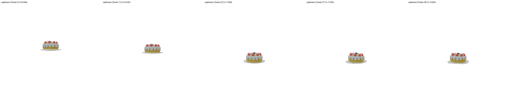

# M5 动态高斯渲染前向迁移验收报告

日期：2026-10-27。M5 已完成“真实网络预测 → MPM 前向仿真 → 动态高斯渲染 → 流式缓存 → 独立换相机回放 → 视频导出”。原仓基线为 PhysGM `7722175ba55db54fd430a7d29a4407b8f8ffe6b6`，实施范围与门槛见 [M5 计划](M5-DYNAMIC_RENDER_PLAN.md)。本阶段只验收前向，不包含 MPM 或动态渲染反向传播。

## 实现结果

`DynamicGaussianRenderer` 接收世界坐标位置、完整 3×3 协方差、SH、概率 opacity 和可选着色旋转；每个目标相机独立计算 SH 后调用 M2 `render_precomputed()`。投影、视锥筛选、排序与合成没有复制，仍由已验收的 M2 CANN 路径执行；没有新增 CANN 算子。

`MPMFrameAdapter` 统一处理仿真坐标逆变换、`FΣFᵀ`、着色旋转、Gaussian ID、区域外静态部分和填充粒子排除。SH0 不做 SVD/着色旋转；SH1–3 保存原仓约定的逆极分解旋转。M4 的 `render_state()` 已委托到同一实现，并保持首个 M1 输入相机的兼容默认值。

相机实现覆盖：

- 配置球面相机的观察中心、竖直方向、方位角/仰角/半径及逐帧增量；轨迹使用绝对帧号，恢复后不重置相位。
- 首个 M1 输入相机，以及固定索引的全部 M1 输入相机。
- 原仓 `cameras.json` 的 rotation/position/fx/fy/width/height，可选非中心 `cx/cy`；缺省主点取图像中心。
- 缺少外部相机时使用原仓 800×800、焦距400的90°视野模板，并按目标分辨率缩放完整内参。

序列格式将共享 SH、opacity、Gaussian ID、静态部分及场景元数据写入 `scene.pt`，每帧单独原子写入 CPU FP32 位置、完整协方差、时间、子步和绝对帧号。SH1–3 额外存旋转。共享包与每个帧文件均有校验值；`SequenceReader` 每次只载入一帧。`render_dynamic.py` 不导入网络或 MPM 求解器，换相机不重新仿真。

## 测试与数值结果

环境为单张 Ascend910B3、Python 3.11.4、PyTorch 2.7.1+cpu、TorchNPU 2.7.1.post8、CANN 9.1.0。

| 检查 | 实际结果 |
| --- | --- |
| M5 CPU | 15 passed，12项NPU专用跳过 |
| M5 NPU | 27 passed |
| 既有 M1/M2/M3 NPU 回归 | 53 passed |
| 既有 M4 NPU 回归 | 41 passed |
| NPU/CPU 小场景 RGB 最大绝对误差 | `1.8441e-7` |
| NPU/CPU 小场景 alpha 最大绝对误差 | `2.6036e-7` |
| 在线/离线完整50帧最大绝对误差 | `0.0` |

CPU 测试覆盖 SH0–3 独立球谐公式、零运动与 M2 静态等价、坐标/协方差变换、Gaussian ID、静态拼接、填充排除、固定/运动/外部相机、非中心主点、恢复轨迹、缓存追加与破坏检测、奇数分辨率视频补边，以及独立回放进程不导入 `model`/`mpm`。NPU 对照覆盖多目标视图、遮挡顺序、空场景、出入视锥及不同背景，误差低于 `rtol=1e-3、atol=2e-4`。

同相机回放的50帧 RGB/alpha 使用编码前 FP32 Tensor 比较，逐元素完全一致。Profiler 确认回放执行现有 `FlashGaussianBuildMask`、`GaussianSort` 和 `CalcRenderFwdDoubleClipGsids` AI Vector kernel，没有执行 MPM kernel，也没有新增算子族。

## 完整 cake 验收

M1 使用真实 checkpoint 严格加载645个模型条目，输入为四张512×512 RGBA，网络精度BF16。M4/M5 保持 `upstream` 模式、100³网格、`dt=2e-4`、200子步/帧、50帧，共10000子步和2秒物理时间。

| 项目 | 实际结果 |
| --- | ---: |
| opacity阈值内原Gaussian | 213532 |
| 实际填充粒子 | 5884 |
| 仿真总粒子 | 219416 |
| 完整流水线总时间 | 444.91 s |
| 仿真＋在线渲染阶段 | 383.76 s |
| MPM求解累计 | 373.80 s |
| 动态渲染累计 | 4.25 s |
| 逐帧缓存导出累计 | 1.42 s |
| NPU峰值分配 | 1,440,034,304 bytes |
| 最大质量相对误差 | `3.97e-7` |
| 流式序列大小 | 517,744,714 bytes |

50帧状态有限、协方差合法性检查通过，粒子数未变化，内部填充粒子没有进入渲染。缓存首帧为绝对帧0、step200、t=0.04；末帧为绝对帧49、step10000、t=2.0。在线、固定回放和运动相机三段视频均通过首尾解码检查，均为512×512、50帧、25 FPS。

固定视角回放总计9.07秒，其中NPU渲染4.40秒；运动相机回放总计7.34秒，其中NPU渲染4.78秒。两次回放报告都明确记录 `network_loaded=false`、`mpm_substeps_executed=0`，Gaussian ID摘要一致。

## 产物与复验

- [在线配置相机视频](results/dynamic_cake/simulation.mp4)
- [同相机独立回放视频](results/dynamic_cake/replay_fixed/simulation.mp4)
- [运动相机独立回放视频](results/dynamic_cake/replay_orbit/simulation.mp4)
- [运动相机五时刻预览](results/dynamic_cake/replay_orbit/preview.png)
- `results/dynamic_cake/sequence/`：共享包、50个逐帧缓存及清单。
- `results/dynamic_cake/cameras.pt`、`replay_fixed/cameras.pt`、`replay_orbit/cameras.pt`：在线与回放相机记录。
- [机器可读验收摘要](reports/dynamic_verification.json)、[完整运行报告](reports/dynamic_cake.json)、[固定回放报告](reports/dynamic_replay_fixed.json)、[运动回放报告](reports/dynamic_replay_orbit.json)。

全流程命令见 [迁移说明](M1-migration_readme.md#m5-动态高斯渲染前向迁移)，一键复验为 `bash scripts/verify_dynamic.sh`。该脚本不会删除已有结果；目标序列已存在时会明确退出，应通过 `PHYSGM_DYNAMIC_OUTPUT` 指定新目录。

本阶段边界保持不变：不含运动模糊、时域插值、额外形变网络、动态训练、MPM反向或动态渲染反向。原 CUDA/Warp 同输入数值对齐仍等待参考包，未用本地CPU检查替代该结论。
