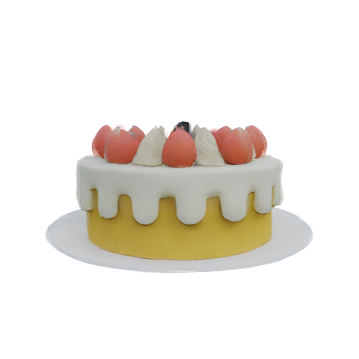

# PhysGM-CANN 迁移说明

以 PhysGM `7722175ba55db54fd430a7d29a4407b8f8ffe6b6` 为基线，在独立项目中使用 PyTorch＋TorchNPU 完成神经网络、静态高斯渲染和监督预训练代码迁移。原仓 `/mnt/workspace/PhysGM` 保持不变。

| 阶段 | 范围 | 当前状态 |
| --- | --- | --- |
| [M1 神经网络迁移](#m1-神经网络迁移) | 多视图图像与相机 → Gaussian、物理属性 | 真实权重推理与网络梯度探针通过 |
| [M2 静态高斯渲染迁移](#m2-静态高斯渲染迁移) | Gaussian 与目标相机 → RGB/alpha，图像梯度回传网络 | 真实渲染、属性反向与网络连接验证通过 |
| [M3 监督预训练迁移](#m3-监督预训练迁移) | 真实图像与物理标签 → 联合损失 → 有效更新、验证与完整恢复 | 100步短训、完整恢复与53项回归通过 |



上图为现有权重在 cake 示例上的真实 NPU 渲染输出，512×512、白背景。预览文件为 [results/render_preview.png](results/render_preview.png)，四视图 RGB/alpha 原始预览保存在 `results/static_512/`。

## 环境

本项目使用独立 uv 环境，Python 3.11、PyTorch `2.7.1+cpu`、TorchNPU `2.7.1.post8`、Transformers `4.57.1`，对应 CANN `9.1.0`。PyTorch CPU 构建提供框架，TorchNPU 提供昇腾设备执行。依据：[Ascend 版本对应表](https://github.com/Ascend/pytorch/blob/master/COMPATIBILITY.en.md)、[uv PyTorch 配置](https://docs.astral.sh/uv/guides/integration/pytorch/)。

```bash
cd /mnt/workspace/PhysGM-CANN
# 本工作区已安装 uv；其他机器可使用自己的 uv。
export PATH="/mnt/workspace/.tools/bin:$PATH"
uv sync --locked --python /usr/local/bin/python

# 运行前加载目标机器的 CANN 环境；本机路径如下。
source /home/developer/Ascend/cann-9.1.0/set_env.sh
```

uv 管理 Python 包，驱动与 CANN 由机器提供。默认启动开发测试依赖；只运行推理时可用 `uv sync --locked --no-dev`。权重和示例准备好以后，模型构建与权重加载完全离线，无须 Hugging Face 登录或下载 DINO。

## M1 神经网络迁移

覆盖完整 DINOv3、相机/Plücker 射线编码、24 层 Transformer、DPT Gaussian 头、三个物理属性头及后处理。纯网络导入与执行不依赖渲染扩展，Attention 使用 PyTorch SDPA，由 TorchNPU 分派 NPU 实现。实际验证记录见 [M1 迁移验证报告](MIGRATION_REPORT.md)。

### 推理与输出

```bash
uv run --locked python infer_network.py \
  --checkpoint checkpoint.pt --device npu:0 --amp-dtype bf16 \
  --output-dir results/npu_forward
```

默认处理 cake 的四张 512×512 RGBA 图像，batch size 为 1。`--config` 可指定配置，`--scene-index` 选择列表中的场景，`--resize` 覆盖输入高度并同步缩放内参。数据路径相对项目根目录；场景内图像路径相对 pose.json。

输出文件：

| 文件 | 内容 |
| --- | --- |
| `prediction.pt` | 仅含 CPU Tensor 与普通类型的输入、预测及权重加载信息 |
| `point_clouds.ply` | 按 opacity 阈值筛选的 Gaussian，保留原仓 SH 与参数存储约定 |
| `predicted_phys.json` | 材料类别，以及原仓归一化逆变换后的 E、ν |
| `run_report.json` | 实际设备、版本、输入形状、权重条目、耗时、峰值内存和状态 |

纯 CPU 调试示例：

```bash
uv run --locked python infer_network.py --device cpu --amp-dtype fp32 \
  --resize 64 --warmup 0 --repeats 1 --output-dir results/cpu_smoke
```

NPU 不可用时明确报错，不会自动切换设备。受限沙箱可能看不到设备节点；本次 NPU 验收使用了沙箱外可见的 Ascend910B3。

### 梯度与算子验证

```bash
uv run --locked python infer_network.py --device npu:0 \
  --backward-probe --resize 256 --profile --output-dir results/npu_backward

uv run --locked python -m pytest -q tests/test_network.py
PHYSGM_TEST_NPU=1 uv run --locked python -m pytest -q tests/test_network.py

# 一次执行 CPU/NPU 测试、512 推理和 256 反向探针
bash scripts/verify_npu.sh
```

梯度探针使用真实图像、相机和现有权重，对各输出构造平方均值标量。检查所有启用参数的梯度存在，各模块梯度有限且总量非零，并确认全局 token 有梯度、DINO 冻结且保持 eval。没有使用监督标签、优化器或参数更新。

`--profile` 在计时结束后单独重放一次，输出 `operators.json`（Chrome trace）、`operator_names.json` 和 Attention 算子名称。TorchNPU 还会生成被 git 忽略的 `export_only_prof_dir/` 原始 profiling 目录。

计时默认先执行一次预热，再记录三次同步前向的中位数和 p95。首次执行包含位置常量缓存与算子初始化；模型加载、传输、输出 I/O 分别记录，不计入预热后前向。`memory` 是 profiling 重放之前的峰值分配与预留内存。

### Python 接口与兼容性

```python
from pathlib import Path
import torch
import yaml
from easydict import EasyDict
from model.physgm import load_checkpoint
from runtime import select_device, autocast

config = EasyDict(yaml.safe_load(Path("configs/network_npu.yaml").read_text()))
device = select_device("npu:0")
model, load_info = load_checkpoint(config, "checkpoint.pt", device)
model.eval()
# batch 的张量需先移动到 device。
with torch.no_grad(), autocast(device, "bf16"):
    prediction = model.predict(batch, return_unpruned=True)
```

嵌入已有程序时，应在第一次 CPU 或 NPU backward 之前调用 `select_device("npu:0")` 或导入 `torch_npu`，让 PyTorch 的 autograd engine 提前注册 NPU。混合设备回归已覆盖这一初始化顺序。

必需输入为 `input_images: [B,V,3|4,H,W]`（浮点、范围 [0,1]）、`input_intr: [B,V,4]`（fx/fy/cx/cy，像素单位）、`input_c2ws: [B,V,4,4]`。H/W 必须是 16 的倍数。`forward` 委托 `predict`；目标视图字段会被忽略，任何模式都不会触发渲染。

返回 `gaussians`（xyz、feature、scale、rotation、opacity）、`gaussian_usage`、`phys_logits`、`E_mu/E_var`、`nu_mu/nu_var`；可选 `gaussians_unpruned` 为过滤前输出。传入的 `pos_avg_inv/scene_scale/scene_name` 作为元数据保留。Gaussian scale 为 log-scale，opacity 为 logits，rotation 未归一化；激活由后续渲染器负责。PLY 导出保持同一约定。`inference_time` 仅为主机提交耗时，准确耗时以 CLI 同步报告为准。

现有权重含完整 DINOv3 参数，严格匹配 645 个模型条目。其 Gaussian 头为 14 通道，必须使用 `sh_degree=0`；原训练配置的 `sh_degree=1` 不能直接加载这份权重。DINO 架构使用 Transformers 4.57.1 的 ViT-L/16 配置，1024 hidden、4096 MLP、24 层、16 heads、4 register tokens，RoPE 与 LayerNorm 使用该版本官方默认值。

保持原仓实际未 resize 的 DINO 预处理、ImageNet 归一化、白背景合成、Gaussian 后处理及 E/ν 单位转换。DINO 在 `model.train()` 后仍冻结并保持 eval。修复了原 forward 提前读取目标相机、Gaussian split view 原地写入和随机 pruning 索引的问题。

CPU 工作包括图像读取/缩放、相机规范化、权重读取、输出文件，以及固定位置编码的生成缓存：射线编码使用原有 bicubic＋antialias；DPT 位置编码保留原 FP64 频率计算后转 FP32。二者都没有可训练依赖，随后缓存到实际执行设备；神经网络算子不因此切换到 CPU。

## M2 静态高斯渲染迁移

独立 `StaticGaussianRenderer` 接收 M1 的原始 Gaussian 和固定目标相机，输出 RGB/alpha/RGBA，并保留图像到 Gaussian、再到网络的一阶计算图。投影、协方差、SH 与参数激活由 TorchNPU 执行；分块、排序及合成前反向使用项目内构建的 CANN 原生算子。

实施过程与完整结果见 [M2 实施计划](STATIC_RENDER_PLAN.md)、[M2 验收报告](STATIC_RENDER_REPORT.md)；详细参数和接口约定见 [渲染接口说明](rendering/README.md)。

### 构建与渲染

先完成上面的 uv 环境初始化并加载 CANN，再构建渲染扩展：

```bash
uv sync --locked --group render-build
uv run --locked --group render-build python scripts/build_renderer.py --jobs 8

# 在线执行 M1 → 静态渲染，默认 cake 四视图、512×512
uv run --locked python render_static.py --online --device npu:0 \
  --output-dir results/static_512

# 也可直接回放 M1 预测包，使用全部 Gaussian
uv run --locked python render_static.py \
  --input-pack results/npu_forward/prediction.pt \
  --output-dir results/static_replay
```

构建依赖由 uv 的 `render-build` 组锁定；原生库、自定义算子与日志均位于项目 `build/`。固定上游为官方 gauss-splat 的 `baf7591a710a86c9a7d810c5997b037723a91811`，来源、许可证与本地修正见 [UPSTREAM.md](third_party/gauss_splat/UPSTREAM.md)。默认构建目标为 `ascend910b`，清理构建目录或更换机器后需重新构建。

| 输出文件 | 内容 |
| --- | --- |
| `rgb_b0_v0.png` 等 | 每个 batch/view 的 RGB 预览；仅导出 PNG 时 clamp 到 [0,1] |
| `alpha_b0_v0.png` 等 | 对应 alpha 预览 |
| `renderer_input.pt` | 完整 CPU Gaussian、相机、分辨率与渲染参数，可独立重放 |
| `renderer_output.pt` | 浮点 RGB/alpha；反向模式额外保存五组属性梯度 |
| `run_report.json` | 设备、输入规模、耗时、内存、可见性与梯度检查结果 |

### 接口与预训练反向准备

```python
from rendering import StaticGaussianRenderer

renderer = StaticGaussianRenderer(sh_degree=0, backend="cann")
# model、batch 和固定目标相机均在同一 NPU 上。
prediction = model.predict(batch)
result = renderer(
    prediction["gaussians"], target_c2ws, target_intr,
    width=512, height=512, background=(1., 1., 1.),
)
rgb = result.rgb      # [B,T,3,H,W]
alpha = result.alpha  # [B,T,1,H,W]
rgba = result.rgba    # [B,T,4,H,W]
# 后续监督损失可直接连接 rgb/alpha。
```

目标相机为刚体 `c2ws [B,T,4,4]`、像素内参 `intr [B,T,4]=(fx,fy,cx,cy)`。Gaussian 保持 M1 的 log-scale、opacity logits、原始 wxyz quaternion 和 SH 系数约定；renderer 内各激活一次。网络可使用 BF16 autocast，renderer 内显式使用 FP32，保留类型转换前后的梯度连接。

图像监督调用须保留计算图：不要包在 `no_grad()` 中，也不要将 Gaussian `detach()`、转 CPU 或经 PLY 重载。CPU Tensor 包供独立重放使用。原生合成支持一阶反向，尚未提供高阶梯度。

已验证 RGB-only、alpha-only 及联合上游梯度到五组原始 Gaussian 属性，并在真实 256×256 四视图上验证图像梯度回传到射线编码、输入投影/归一化、Transformer、DPT 和全局 token。DINO 保持冻结/eval；物理头需连接独立的材料/E/ν 监督，单独的图像梯度不会经过物理头。

```bash
# 真实网络 → 渲染 → 固定图像上游梯度，仅检查计算图
uv run --locked python render_static.py --online --device npu:0 \
  --input-resize 256 --backward-probe --profile \
  --output-dir results/static_network_backward

# 一次完成构建、回归测试、512 渲染与 256 网络反向
bash scripts/verify_static.sh
```

这里的梯度探针没有监督损失模块、训练循环、优化器或参数更新；当前交付完成预训练所需的渲染一阶反向连接。

### 已验证结果

以下为本机 Ascend910B3、CANN 9.1.0 上的 cake 示例结果。前向耗时为预热后同步中位数，反向为单次计时，均不包含 I/O。

| 检查 | 结果 |
| --- | --- |
| M1＋M2 回归测试 | 33 passed，包含 CPU double gradcheck 与 NPU 图像/梯度对照 |
| 512×512 四视图渲染 | 输入全部 1,048,576 个 Gaussian，前向 0.1665 秒 |
| 512 四视图五组属性反向 | 梯度有限且各组总量非零，反向 0.2750 秒 |
| 256×256 四视图网络＋渲染 | 前向 0.2004 秒，完整反向 0.6296 秒 |

数值、性能与算子证据见 [512 渲染报告](reports/static_512.json)、[512 属性反向报告](reports/static_512_backward.json)、[网络图像反向报告](reports/static_network_backward.json) 和 [小场景数值验证](reports/static_numeric.json)。

CPU 工作包括输入/相机预处理、固定位置常量缓存、tile 数量调度元数据和文件导出；Gaussian 投影、排序、颜色和合成前反向在 NPU 执行。NPU 不可用或原生扩展未构建时明确报错。CPU 小规模参考需显式指定 `--backend reference --device cpu`，具有规模保护。

当前实机验证覆盖 910B3；910C 和同批 GPU gsplat 数值对齐尚待独立验收。

## M3 监督预训练迁移

在 M1 与 M2 上接入真实 RGB/alpha、材料、E/ν 联合监督，支持 AdamW、BF16/FP16/FP32、梯度累积与裁剪、单卡/HCCL DDP、从头初始化、完整断点恢复和独立验证。DINO 始终冻结/eval，其余默认334,816,530个参数参与训练。

```bash
uv sync --locked --group train --group render-build
uv run --locked --group train python scripts/prepare_physassets.py

# 100 次有效更新，真实官方子集，256×256、4输入/8目标视图
uv run --locked --group train python train_pretrain.py \
  --config configs/pretrain_smoke.yaml --init-checkpoint checkpoint.pt \
  --audit --output-dir results/my_pretrain_smoke

# 同一配置完整恢复；保留优化器、调度器、RNG与数据位置
uv run --locked --group train python train_pretrain.py \
  --config configs/pretrain_smoke.yaml --resume auto \
  --output-dir results/my_pretrain_smoke
```

使用 M2 已构建的本地渲染扩展。官方数据准备默认20场景（16训练/4验证），本次只下载52MiB归档前缀；原始真实标签和逐文件校验值保留在数据清单。正式512配置使用每卡batch1/累积8；从头配置只加载现有checkpoint中的DINO权重。

损失为白背景RGB MSE、alpha MSE、one-hot材料BCE以及E/ν的Gaussian NLL+MSE，保留原训练标签单位。可选VGG LPIPS默认关闭，显式准备官方权重后离线运行。默认确定性运算，训练状态在完整累积窗口后原子保存。

完整命令、数据接口、从头初始化、多卡和恢复约定见 [M3训练说明](training/README.md)；[实施计划](PRETRAIN_PLAN.md)与[验收报告](PRETRAIN_REPORT.md)记录实际测试、步数与限制。全矩阵复验命令为 `bash scripts/verify_pretrain.sh`。

本次正式短训产物位于 `results/pretrain_final/`，可恢复断点为 `last.pt`；[第100步真实目标/预测对照](results/pretrain_final/vis_000100/comparison.png)与[完整验收摘要](reports/pretrain_verification.json)可直接查看。连续训练与中断恢复后的全部梯度、参数更新逐元素一致。真实双NPU及同批GPU数值对齐仍待独立验收。
